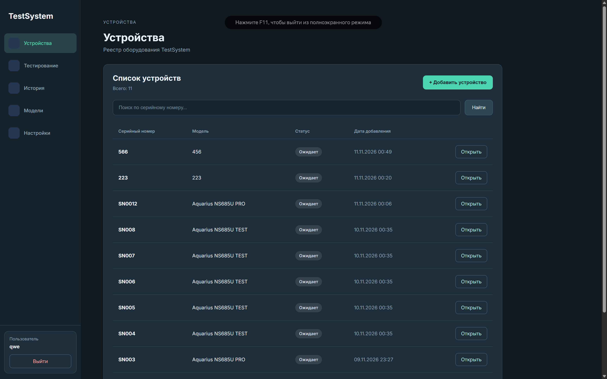
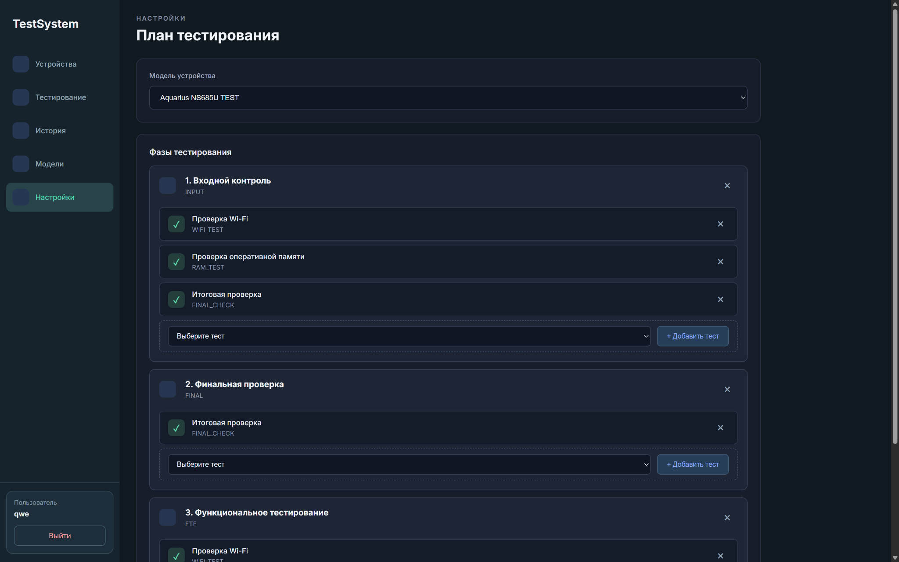
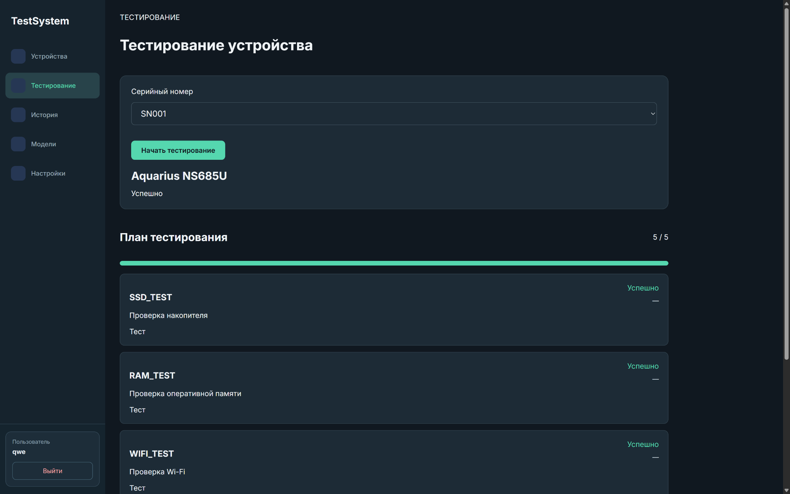
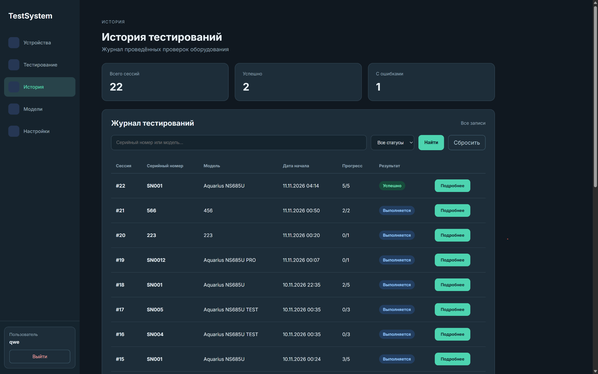
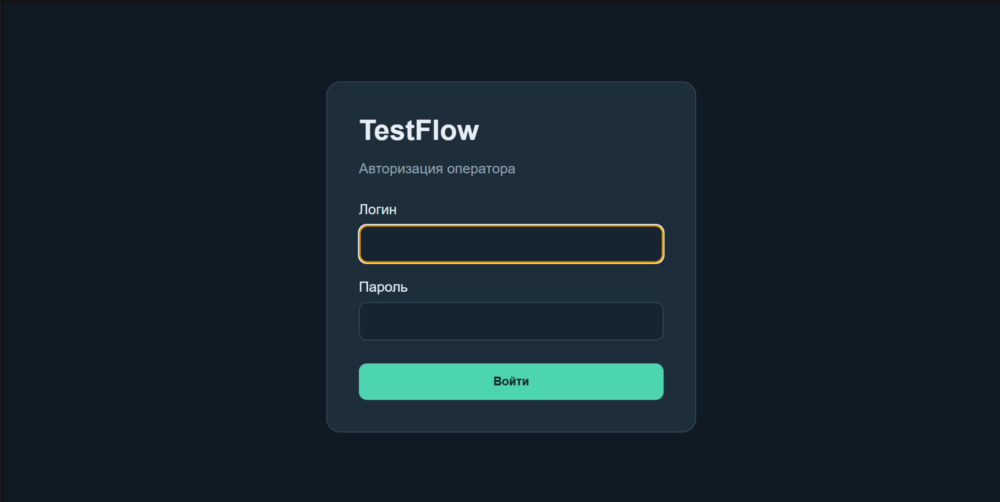
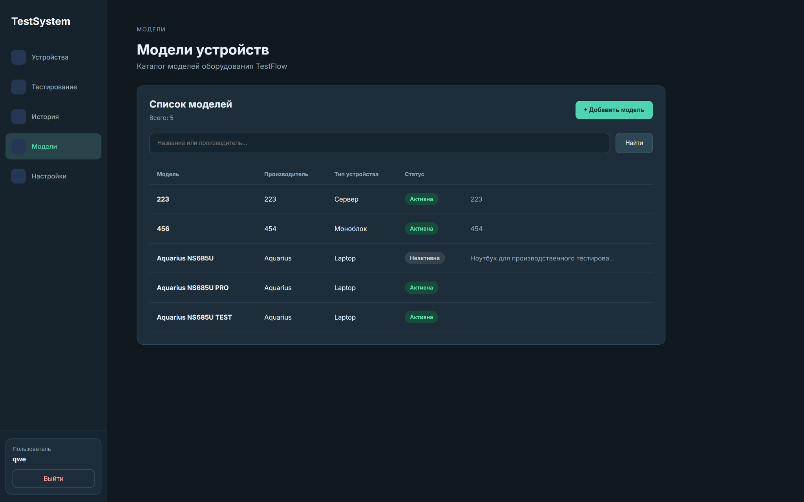
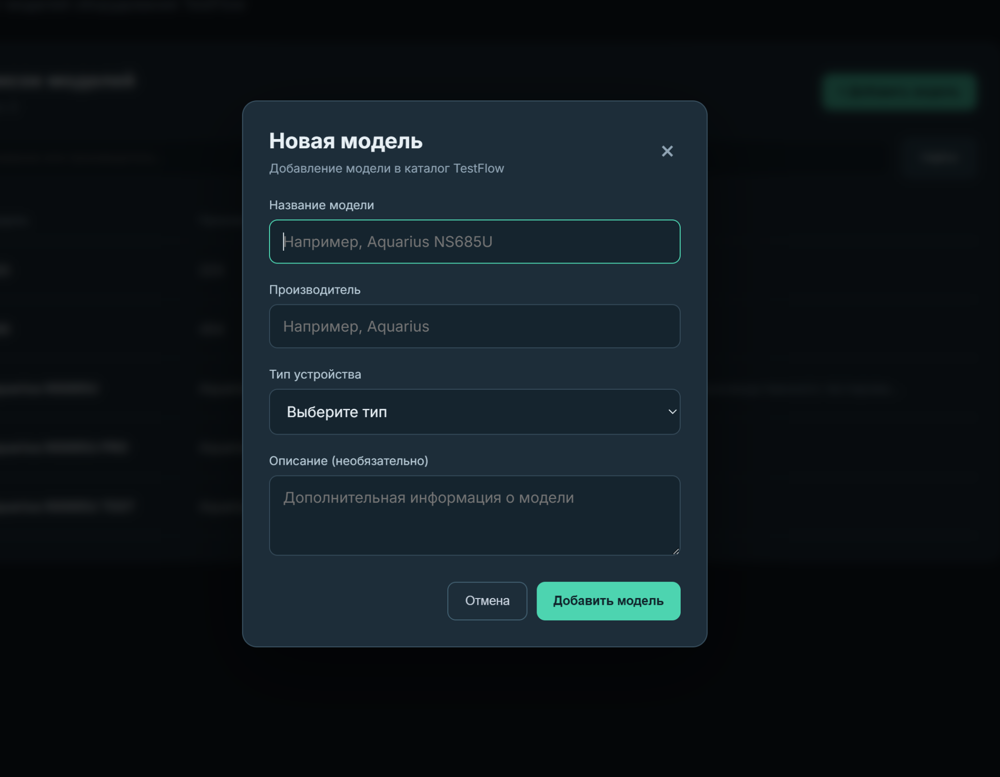
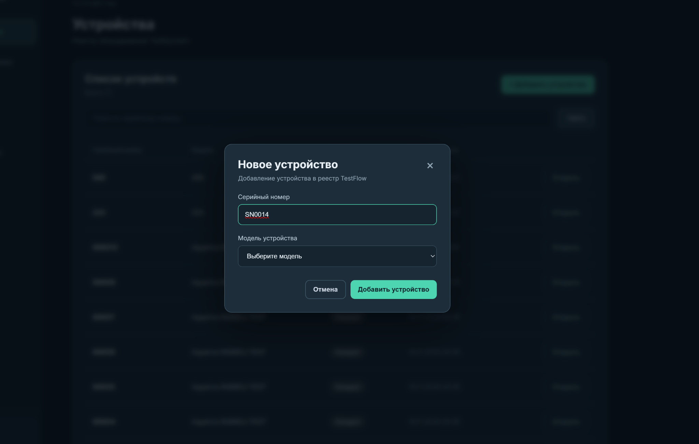

<div align="center">

# 🧪 TestSystem

### TestFlow — система управления тестированием компьютерного оборудования

**От регистрации устройства до истории результатов — в одном интерфейсе.**


**[Возможности](#-возможности) · [Интерфейс](#-интерфейс) · [Архитектура](#-архитектура) · [Запуск](#-локальный-запуск)**

*設計 · 開発 · 改善 — Learning · Building · Improving*

</div>

---

## 🎯 О проекте

**TestFlow** — учебный full-stack проект на Django, моделирующий процесс тестирования компьютеров и ноутбуков. Он помогает вести каталог оборудования, задавать планы проверок для разных моделей, отмечать результаты и просматривать историю тестовых сессий.

Цель проекта — практическое изучение Python Backend: проектирования моделей данных, Django ORM, серверной логики, авторизации и взаимодействия с веб-интерфейсом.

## ⚙️ Возможности

- **Реестр устройств:** серийные номера, модели, статусы и поиск.
- **Каталог моделей:** производитель, тип устройства, описание и активность.
- **Планы тестирования:** фазы, последовательность и набор тестов для каждой модели.
- **Тестовые сессии:** запуск проверки, фиксация успешных и неуспешных результатов, прогресс выполнения.
- **История:** журнал сессий, фильтрация и просмотр результатов.
- **Авторизация:** вход оператора в систему.

## 🖥️ Интерфейс

### 01 / Реестр устройств



Регистрация оборудования и отслеживание статусов по серийному номеру.

### 02 / Конструктор плана тестирования



Настройка этапов и состава проверок для выбранной модели оборудования.

### 03 / Выполнение тестов



Отображение текущей сессии, выполненных проверок и общего прогресса.

### 04 / История результатов



Журнал сессий с поиском, статусами и переходом к деталям.

<details>
<summary><b>📷 Другие экраны: авторизация, модели и формы добавления</b></summary>

#### Авторизация


#### Каталог моделей


#### Добавление модели


#### Добавление устройства


</details>

## 🧩 Архитектура

| Слой | Реализация |
| --- | --- |
| Backend | Python, Django |
| Данные | SQLite, Django ORM |
| Интерфейс | Django Templates, HTML, CSS, JavaScript |
| Логика тестирования | Модели, представления и сервисный слой |
| Авторизация | Django Authentication |
| Статика | WhiteNoise |

**Основные сущности:** `DeviceModel`, `Device`, `Phase`, `ModelPhase`, `TestDefinition`, `TestPlanItem`, `TestSession`, `TestRun`, `TestResult`.

```text
config/                  # Настройки проекта
 testing/                # Django-приложение
   models.py             # Сущности и связи
   views.py              # Обработка запросов
   services.py           # Прикладная логика
   templates/            # HTML-шаблоны
   static/               # Стили и JavaScript
   migrations/           # Миграции базы
manage.py
requirements.txt
```

## 🚀 Локальный запуск

**Требуется:** Python 3.12+ и Git. Команды ниже — для Windows CMD.

```bat
git clone https://github.com/rusakovm/TestSystem.git
cd TestSystem
python -m venv .venv
.venv\Scripts\activate
pip install -r requirements.txt
```

Создайте локальный `.env` (не добавляйте его в Git):

```dotenv
DJANGO_SECRET_KEY=your-own-generated-secret-key
DJANGO_DEBUG=True
```

Сгенерировать ключ можно командой:

```bat
python -c "from django.core.management.utils import get_random_secret_key; print(get_random_secret_key())"
```

Затем:

```bat
python manage.py migrate
python manage.py createsuperuser
python manage.py runserver
```

Откройте **http://127.0.0.1:8000/** и войдите под созданной учётной записью.

> Для демонстрации функциональности после запуска потребуется создать модели оборудования, устройства и планы тестирования. Демонстрационная база данных в репозиторий не включена.

## 🛠️ Дальнейшее развитие

- Расширение REST API и интеграций.
- Автоматизация проверок оборудования.
- Расширение валидации, отчётности и тестового покрытия.
- Доработка интерфейса и пользовательских сценариев.

---

<div align="center">

Разработчик: **[Konari / rusakovm](https://github.com/rusakovm)**

*Learning · Building · Improving*

</div>
